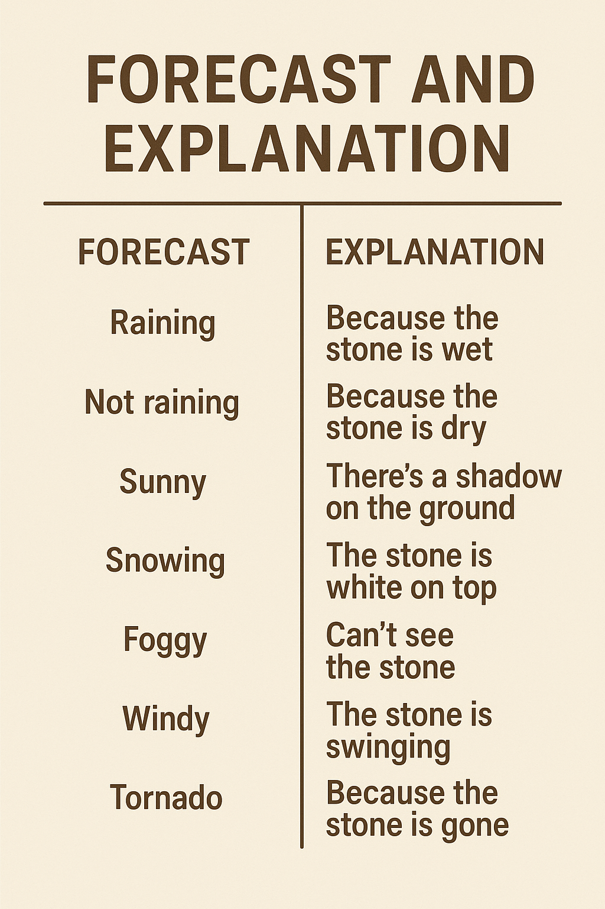
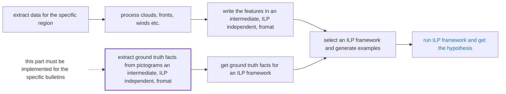

# SERGIO, Forecast Explanation

SERGIO (<b>S</b>imlulating <b>E</b>xplanation of <b>R</b>e<b>GIO</b>nal weather forecast) is a framework aiming to provide simple explanations to weather forecasts made by experts (leveraging Machine learning), by using Inductive logic programming.

<div align="center">

</div>

## Installation

To run the framework, clone the repository, change the parameters for the learning task and run docker:

```bash
# 1. Clone (with the CUDatILP submodule)
git clone --recurse-submodules https://github.com/EnrSanti/ForecastExplanation.git
cd ./ForecastExplanation

# 2. Configure credentials (CDS API key for CERRA GRIB downloads)
cp .env.example .env   # then set ECMWF_API_KEY

# 3. Edit config.yaml with your desired run(s) (region, dates, flags)

# 4. Run the published image...
docker compose up

# ...or build it from the sources
docker compose -f docker-compose-local.yaml up --build
```

A CDS API key is required for CERRA GRIB downloads — see the [CDS API setup guide](https://cds.climate.copernicus.eu/how-to-api) and place your credentials in the file `.env`.

To run without Docker, install [uv](https://docs.astral.sh/uv/) and run `uv sync` then `uv run src/main.py` (`uv sync --extra gpu` for CUDA training). On Linux the ecCodes library comes from the system (e.g. `apt install libeccodes0`), as in the Dockerfile.

## Training Configuration

Use the file `config.yaml` to set up a run for a specific region.
Runs are configured via `config.yaml`. Each top-level key names a run, with the following options set per region/date combination:

%% todo update this
| Key             | Type                                     | Description                                                                             |
|-----------------|------------------------------------------|-----------------------------------------------------------------------------------------|
| `region.bounds` | `[LONG_MIN, LONG_MAX, LAT_MIN, LAT_MAX]` | Geographical bounding box to extract and process                                        |
| `region.cities` | map of `city: {lat, lon}`                | Named cities within the region, used for per-city feature/label extraction and overlays |
| `dates`         | list of `YYYY-MM-DD`                     | Dates to analyze                                                                        |
| `clean`         | `true` \| `false`                        | Remove downloaded `.GRIB` files after processing                                        |
| `clustering`    | `true` \| `false`                        | Run TOBAC on clustered images instead of raw ones                                       |
| `debug`         | `true` \| `false`                        | Enable debug logging                                                                    |
| `force`         | stage name                               | Recompute this stage and the following ones (`extraction`: rebuild the feature maps)    |
| `stop_after`    | stage name                               | Last stage to run (`data`: only download and cut the GRIB files)                        |
| `save_images`   | `true` \| `false`                        | Save TOBAC's input/output images, for visually checking detection quality               |
| `workers`       | integer (default `12`)                   | Parallel processes used by data extraction, TOBAC, reasoning and translation            |

## Current pipeline
